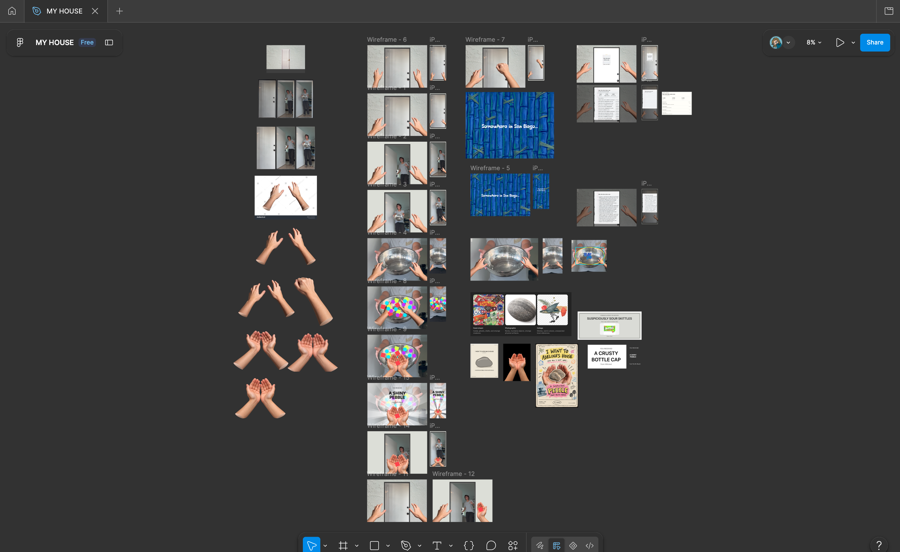
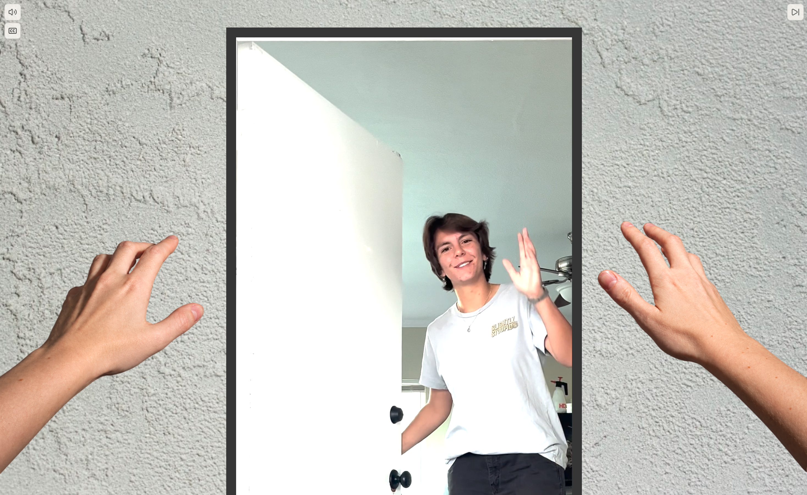

# MY HOUSE 🏠

You're invited to MY HOUSE!

MY HOUSE is an interactive web experience where you knock on my door, rummage through a bowl of questionable goodies, and leave with a strange random gift.

Inspired by mixed-media animation, absurdist humor, and a little bit of San Diego. 

Completed and launched in October 2026. A personal creative coding experiment designed and developed by Adelina Martinez.

**[Come visit MY HOUSE →](https://my-house-umber.vercel.app/)**
**[Read the LinkedIn launch post →](https://lnkd.in/p/gtDKE5ys)**

## How it works

1. Knock on the door.
2. Watch the greeting.
3. Dig through the bowl.
4. Receive a random gift.
5. See who else has visited in the guestbook.

The experience includes 100 possible objects, combined with randomized descriptions and locations. Some are treats. Some are not.

## Built with

- TypeScript, HTML, and CSS
- GSAP for animation
- Supabase and PostgreSQL for public guestbook
- Vite and Vercel

## Creative process

- Prerecorded video footage
- [Figma storyboarding](https://www.figma.com/design/wAK4qBfrU0VsLNVt6voe82/MY-HOUSE?node-id=0-1&t=1qRyOltRgXJWsL0J-1) and prototyping
- Mixed-media visual direction inspired by animation and internet art
- Sourced photography and transparent image assets

## Features

- Interactive door-knocking and rummaging mechanics
- Cursor- and touch-driven hand interactions
- Randomized gifts and descriptions
- Anonymous visitor sessions
- Public guestbook backed by Supabase
- Responsive desktop and mobile layouts
- Captions, audio controls, and video controls

